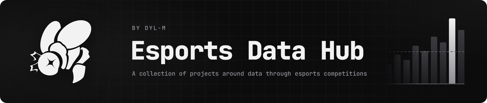

[](https://www.python.org/)
[](https://github.com/astral-sh/uv)
[](https://github.com/astral-sh/ruff)
[](LICENSE)


[](https://github.com/Dyl-M/esports-data-hub/actions/workflows/test-coverage.yml)
[](https://app.deepsource.com/gh/Dyl-M/esports-data-hub/)
[](https://app.deepsource.com/gh/Dyl-M/esports-data-hub/)

## Projects

**Esports Data Hub** (EDH) gathers several data projects built on esports competition results, each in its own
subpackage of `edh` with its own README, sharing the same tooling and data sources. Match data comes from
[Liquipedia](https://liquipedia.net/) through [`liquipydia`](https://github.com/Dyl-M/liquipydia).

| Project                                         | Package           | Status                                 |
|-------------------------------------------------|-------------------|----------------------------------------|
| [League play scenarios](#league-play-scenarios) | `edh.scenarios`   | In use                                 |
| [Rating predictions](#rating-predictions)       | `edh.predictions` | Started: match history from Liquipedia |

### League play scenarios

Given the results already played in a round-robin league, works out how each team can finish once the remaining series
are played, exactly or by Monte Carlo sampling, and renders the outlook as a shareable card. Every possiblescore of a
remaining series counts as equally likely, so the shares describe what is still open, not predictions.

Targets: Coupe de France Slash 2026 and the RLCS Clubs Championships League Play (its seven regions are configured,
waiting for the schedule). It succeeds [`league-play-scenarios`](https://github.com/Dyl-M/league-play-scenarios).

```bash
uv run python -m edh.scenarios.run cdf_slash_2026 --visual     # fetch from Liquipedia, evaluate, render the card
uv run python -m edh.scenarios.run cdf_slash_2026 --source csv # offline, from the saved results.csv
```

- **[Running it](edh/scenarios/README.md)**: leagues and `league.json`, every option, method choice, outputs, the
  outlook card
- **[How it works](_docs/scenarios.md)**: probability model, tiebreakers, the math of the exhaustive, winners-first
  and Monte Carlo methods, aggregation

### Rating predictions

Per-game win probabilities learned from past results, to replace the equally likely scores of the league play scenarios.
It starts with the match history: Rocket League tiers 1 and 2 since September 2024, fetched from Liquipediaand cached
locally.

```bash
uv run python -m edh.predictions.run      # update the local match history, then summarize it
```

- **[Running it](edh/predictions/README.md)**: history scope, cache, updates, reading the matches from Python

## Setup

The project uses [uv](https://docs.astral.sh/uv/) and Python 3.13.

```bash
uv sync                                   # install dependencies (dev tools included)
uv run playwright install chromium        # once, only to render outlook cards
```

Liquipedia data needs an [LPDB API key](https://liquipedia.net/api), read from the `LPDB_API_KEY` environment variable,
or else from the `lpdb` field of `.tokens/local_keys.json` (gitignored):

```json
{
  "lpdb": "<your key>"
}
```

Each project's README lists what it needs on top of this.

## Repository structure

```
esports-data-hub/
├── .github          # GitHub Actions workflows (tests & coverage, license year), Dependabot config, CODEOWNERS
├── _data            # One folder per league: league.json (format), results.csv and event.json (Liquipedia snapshots)
├── _docs            # How each project works: models and math, independent of the code
├── _tests           # Pytest test suite, CSV / recorded Liquipedia / placeholder visual fixtures, shared configuration
└── edh              # Main application package: exceptions, paths, brand, lpdb (shared Liquipedia access)
    ├── predictions  # Rating predictions: match history (cached in .cache/lpdb/, gitignored), run.py (CLI)
    └── scenarios    # League play scenarios: models, config, standings / tiebreakers, engine, report, run.py (CLI)
        ├── sources  # Result sources: Liquipedia (through liquipydia) and CSV, event details snapshot
        └── visuals  # Outlook card: HTML rendering (Jinja2) and PNG export (Playwright)
```

## Development

```bash
uv run pytest -m "not integration and not browser"   # tests run by CI (see below)
uv run ruff check .                                  # lint
uv run ruff format --check .                         # format check
uv run mypy edh                                      # type check
```

Two opt-in test markers stay out of CI: `integration` calls the live Liquipedia API (needs an LPDB API key), `browser`
renders cards with Playwright's Chromium.

> Code is reviewed by the [DeepSource](https://deepsource.io/) bot.
